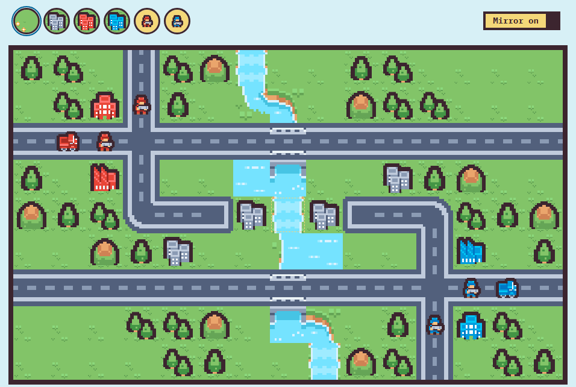
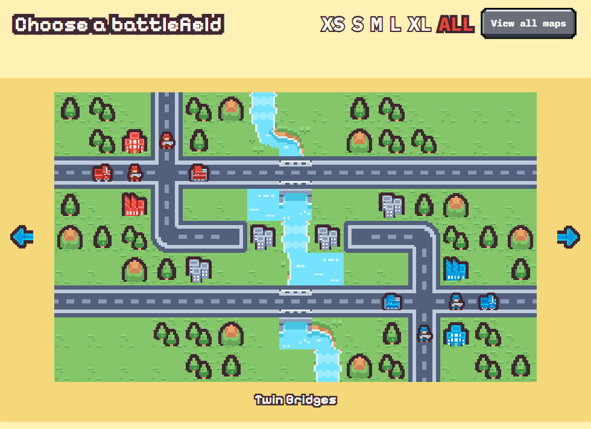

# Pixel’s War 1.6 – Challenge a friend on your own map

Hello Commander,

## Core features

- Editor: You can now play on your own battlefield, save it and send a friend a link to play. You can also take on the AI or share a device. The map editor has been greatly improved.

## Gameplay

- Movement: After boarding or unloading, you choose which unit moves next.
- Success: Earn "Onliner" for finishing an online match or "In the same boat" for finishing one on a shared device.

## Performance

- Big improvement in term of performance, the homepage and the map board load faster than never

## UX improvements

- Scout maps before playing, see more of the board on mobile
- Many small fixes and tweaks to improve your experience

Thanks to [u/Taxtengo](https://www.reddit.com/user/Taxtengo/), [u/artemi7](https://www.reddit.com/user/artemi7/), [u/Landy0451](https://www.reddit.com/user/Landy0451/) and Cynthia for the feedback!

[Play Pixel’s War](https://pixelswar.io/)
