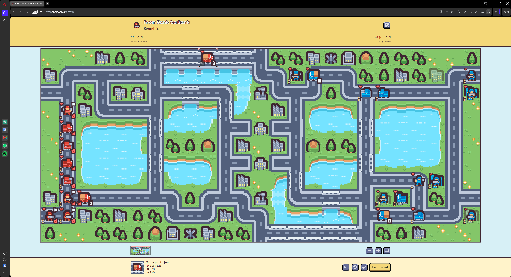

# Pixel’s War



**Capture cities. Build your army. Outsmart the AI or a friend.**

A pixel-art, turn-based strategy game for desktop and mobile.
**[Play in your browser](https://pixelswar.io/)** — no installation required.

- 30 built-in battlefields, 14 unit types and six terrain types.
- Create your own maps, save them in your browser and play them in any mode.
- Four AI difficulties, local two-player battles and online duels through WebRTC.
- English, French, German and Japanese, with keyboard, mouse and touch controls.

[What’s new in 1.6](docs/release-notes-1.6.md)

## Play

Choose a battlefield from the shuffled carousel or filter the grid by size. The
carousel favours a first map that fits your screen. Blue plays first. Against the AI,
you command red. Destroy all opposing units to win.

Infantry capture buildings. Cities earn income, hospitals heal units, and army bases,
airports and naval bases produce reinforcements. Transport jeeps and helicopters carry
infantry. Transport ships can also ferry ground vehicles.

| Action                                   | Keyboard                               |
| ---------------------------------------- | -------------------------------------- |
| Move                                     | Arrows or selected ZQSD / WASD layout  |
| Confirm                                  | Enter                                  |
| Cancel / close                           | Escape                                 |
| Capture / secure                         | Space                                  |
| Cell statistics                          | I                                      |
| Transport passengers                     | T (selected transport with passengers) |
| Next available unit / previous selection | Tab / Shift + Tab (board focused)      |
| End turn                                 | End (board focused)                    |

Drag to pan, wheel or pinch to zoom, and use the overview button to fit the map.
Select a tile and open its thumbnail in the action bar for terrain and unit stats.
Select an enemy with no friendly unit selected to see its movement and attack range.
**Options and help** contains the rules and audio, animation and keyboard settings.

Choose **Play 1v1 online** on the published site, create a game and send the
invitation link to a friend. The host plays blue and the guest plays red. PeerJS Cloud helps
the browsers connect. They exchange game data over WebRTC, directly or through
a relay. Your opponent’s browser may learn your IP address, so share invitations
with people you trust. Keep both pages open for the match. [Terms and privacy](https://pixelswar.io/terms/)

## Create a map

Open **Create a map** on the homepage to paint terrain, buildings and starting
armies. Mirror mode rotates each placement 180° and swaps team colours. Save
work in progress at any time. Once both armies are on the board, select the saved
map in the chooser to face the AI or a friend. Online guests receive the map
from the host. Use **Export** and **Import** to share an editable JSON copy.

## Progress and support

Beat a built-in map against the AI to earn its difficulty medal. Finishing an
online match unlocks **Onliner**. Finishing one on a shared device unlocks
**In the same boat**.

Use **Progression & settings** to back up your medals, achievements, nickname,
preferences and saved custom maps as JSON. Importing previews the backup before
restoring your profile and merging maps by ID. One unfinished AI match is saved
separately in this browser and can be resumed from the homepage.

**Contribute** offers PayPal and Ethereum Mainnet. Payment destinations are
configured in `src/lib/support.ts`. Contributions grant no gameplay advantages.

## Develop

Requires **Node.js 22.17.0 or newer**. The game uses SvelteKit 3, Svelte 5,
Vite 8, TypeScript 6 and Paraglide JS 2. SvelteKit’s static adapter prerenders
the site for GitHub Pages.

```sh
npm ci
npm run dev
```

Use `npm run map:editor` to start the dev server at the editor. To preview the
production site, run `npm run build` followed by `npm run preview`. The static
files are written to `build/`, including the `404.html` fallback.

Built-in maps use `/play/<map-id>/`. The default is shared-device multiplayer.
Add `?ai=easy` (or `medium`, `hard`, `expert`) for solo play or `?online=1` for
an invitation. Saved custom maps use `/play/local/?id=<local-map-id>`.
The unit sandbox at `/play/dev/` and map drafts at `/play/draft-<id>/` are
available on the dev server.

### Checks

Run the CI checks after `npm ci`. Formatting reports warnings without blocking
the workflow. [CI workflow](.github/workflows/ci.yml)

```sh
npm run format:check
npm run check
npm test
npm run build
node node_modules/@playwright/test/cli.js install --with-deps chromium
npm run test:e2e -- --grep-invert "stays responsive on large map"
npm run test:e2e -- tests/e2e/ai-performance.spec.ts --project desktop --workers 1 --output test-results/ai-performance
npm run test:e2e:dev -- --workers 2 --output test-results/drafts
```

`npm run format` applies formatting. The browser suite exercises the production
build in desktop and mobile Chromium and uses a local PeerServer for online
matches. CI measures AI responsiveness with one worker and tests drafts against
the dev server. The public relay has its own diagnostic, `npm run test:turn`.

### Project layout

| Location              | Purpose                                                      |
| --------------------- | ------------------------------------------------------------ |
| `src/lib/game/`       | Rules, state, AI, input and online protocol                  |
| `src/lib/map-editor/` | Editor model, JSON import/export and local map storage       |
| `src/lib/components/` | Board, dialogs and controls                                  |
| `src/lib/data/`       | Maps, map registry and preview metadata                      |
| `messages/`           | Four source translations                                     |
| `assets/`             | Artwork and audio sources                                    |
| `scripts/`            | Asset sync, translations, map thumbnails and TURN diagnostic |
| `tests/`              | Rule tests, fixtures and browser regression suite            |

Use Svelte runes for reactive UI state and keep game rules separate from DOM rendering.
Formatting uses tabs, single quotes, no semicolons and no trailing commas.
Online peers compare map and rule fingerprints. Bump `protocolVersion` in `peer.ts`
when command semantics or combat rules change.

- Installation, dev and production builds synchronize artwork from `assets/`.
  The game preloads battlefield sprites at high priority while the remaining
  sprites load in parallel. [Asset formats and naming](assets/README.md)
- To publish a built-in map, register its numeric ID in `map-files.json` and
  the play route, then add its translated title. Retired IDs stay reserved for
  existing links and saves. Medal revisions default to 1 for registered maps.
  Bump a map’s revision in `src/lib/profile.ts` when a redesign changes its
  challenge. [Map editing and submissions](docs/map-editor.md)
- Dev and production builds generate the chooser metadata. To refresh thumbnails
  after a map or artwork change, run `npm run generate:map-previews` with the dev
  server running, Playwright Chromium installed and Pillow available to Python.
  The script checks lossless WebP previews against their PNG fallbacks. Set
  `PREVIEW_BASE_URL` or `PYTHON` to override the server or interpreter.
- Edit translations in `messages/`. `npm run check` regenerates them automatically.
  Use `npm run generate:i18n` to regenerate them separately. Vite uses compact
  locale modules during development and tree-shakable messages for production.
- Further reading includes [AI behaviour](docs/ai.md), [combat effects](docs/combat-effects.md),
  [solo match saves](docs/saved-matches.md) and [itch.io packaging](distribution/itch/README.md).

Unit statistics and terrain costs live in `catalog.ts`. Damage and matchups live in
`combat-rules.ts`. Production menus enumerate the catalog. Add corresponding
sprites, translations and tests when introducing a unit.

## Deploy and configure TURN

For local relay support, copy `.env.example` to `.env.local`. Set
`VITE_METERED_APP` to the app name or its `.metered.live` hostname and
`VITE_METERED_TURN_API_KEY` to a **credential-scoped TURN API key**. Restart
Vite. With both settings empty, development uses public STUN only.

For GitHub Actions, set repository variable `METERED_APP` and secret
`METERED_TURN_API_KEY`. The build embeds this key in the public browser bundle.
Keep the account Secret Key and Project API Key private. Monitor the TURN quota
and rotate the credential-scoped key if necessary. [Metered reference](https://www.metered.ca/docs/llms-turn-server.txt)

`npm run test:turn` checks two peers forced through the configured relay and
consumes a little relay bandwidth. Set `VITE_TURN_RELAY_ONLY=true` to force a
test match through TURN. The default is `false`.

In repository **Settings → Pages**, select **GitHub Actions** and keep the custom
domain `pixelswar.io`. Run **Actions → Deploy GitHub Pages → Run workflow** on the
branch to publish. This manual workflow runs type checks and unit tests, verifies
both Metered settings are present, then builds and deploys `build/` with an
empty `BASE_PATH`. [Deployment workflow](.github/workflows/pages.yml)

## Credits

Programming: [John Does it](https://johndoesit.be).
Sprites: [Kenney — Tiny Battle](https://kenney.nl/assets/tiny-battle).
Muzzle flashes and explosion effects: [bdragon1727](https://bdragon1727.itch.io).
Typography: [Pixelify Sans](https://github.com/google/fonts/tree/main/ofl/pixelifysans), hosted locally under the [SIL Open Font License](src/lib/fonts/OFL.txt).
Body text and controls: [IBM Plex Mono](https://github.com/google/fonts/tree/main/ofl/ibmplexmono), hosted locally under the [SIL Open Font License](src/lib/fonts/ibm-plex-mono/OFL.txt).
Japanese text: [DotGothic16](https://github.com/google/fonts/tree/main/ofl/dotgothic16), hosted locally under the [SIL Open Font License](src/lib/fonts/dotgothic16/OFL.txt).
Sounds: [Pixabay](https://pixabay.com/fr/sound-effects).
Music: [Monolith](https://arcofdream.bandcamp.com/album/monolith-official-soundtrack).
QA: Gauthier Miessen.

Special thanks to [u/Taxtengo](https://www.reddit.com/user/Taxtengo/), [u/artemi7](https://www.reddit.com/user/artemi7/), [u/Landy0451](https://www.reddit.com/user/Landy0451/), and Cynthia for all the feedback.

Feedback and contributions: [GitHub issues](https://github.com/john-does-it/pixelswars/issues).
