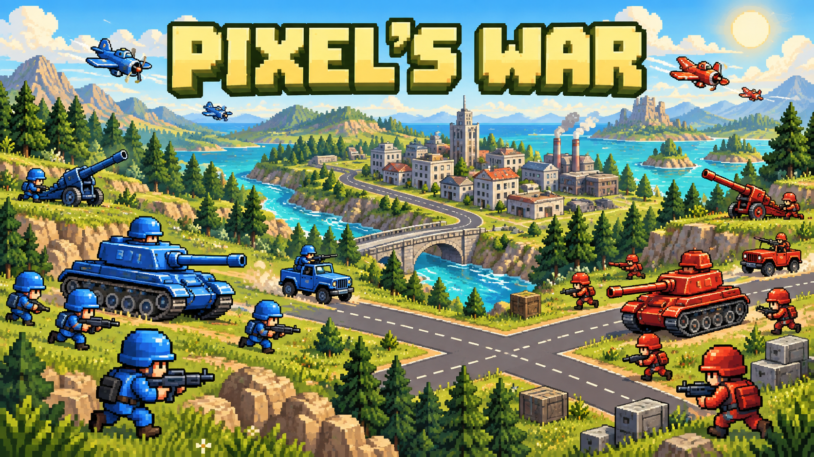
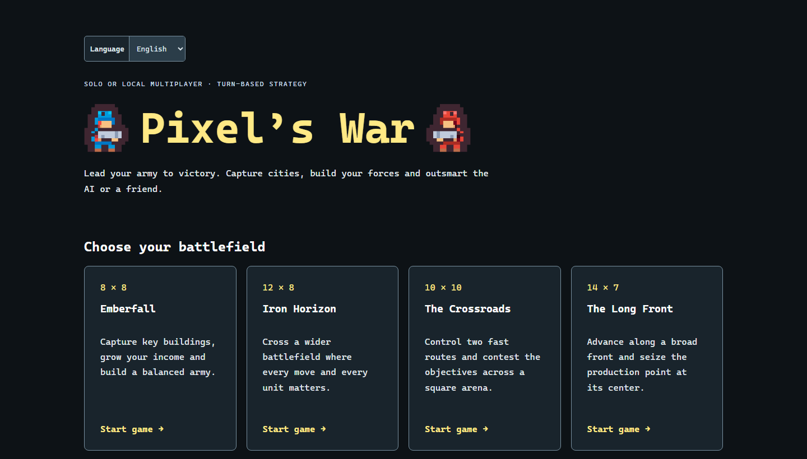
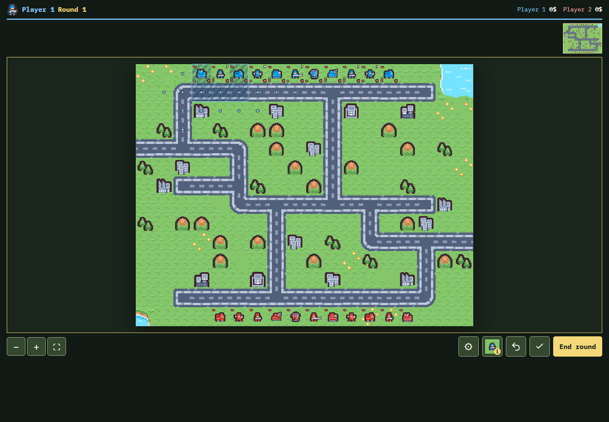

# Pixel’s War



**Capture cities. Build your army. Outsmart the AI or a friend.**

A pixel-art, turn-based strategy game for desktop and mobile.
**[Play in your browser](https://pixelswar.io/)** — no installation required.

- 20 battlefields, 11 unit types and a map editor.
- Four AI difficulties, local two-player battles and online duels through WebRTC.
- English, French, German and Japanese; keyboard, mouse and touch controls.




## Play

Destroy all opposing units to win. Move, attack and capture with any available unit,
then end your turn. Cities and oil fields earn income; army bases and airports
produce reinforcements. Infantry can board transports and deploy beside them.
Blue plays first; against the AI, you command red.

| Action               | Keyboard                               |
| -------------------- | -------------------------------------- |
| Move                 | Arrows or selected ZQSD / WASD layout  |
| Confirm              | Enter                                  |
| Cancel / close       | Escape                                 |
| Capture / secure     | Space                                  |
| Cell statistics      | I                                      |
| Transport passengers | T (selected transport with passengers) |

Drag to pan, wheel or pinch to zoom, and use the overview button to fit the map.
The bottom preview shows the hovered unit or terrain; click it for full details.
Options and help contains the rules and audio, animation and keyboard settings.

For online play, choose a map, create an invitation and send its link to a friend.
Keep both pages open: refreshing or closing ends the session. The host validates
and shares game state; this mode is intended for friends. Connecting contacts
PeerJS Cloud and configured STUN/TURN services. Use the published site for invitations
between devices. See [terms and privacy](https://pixelswar.io/terms/).

## Develop

SvelteKit 2, Svelte 5 and Paraglide. Requires Node.js 22.14 or newer.

```sh
npm ci
npm run dev
```

Games use `/play/<map-id>/`; add `?ai=easy`, `medium`, `hard` or `expert`, or
`?online=1`. Without a mode parameter, play is local multiplayer. `/play/dev/`
is a development-only unit sandbox. Production output is `build/`, served over HTTP.

Run the same checks as CI:

```sh
npm run format:check
npm run check
npm test
npm run build
node node_modules/@playwright/test/cli.js install chromium
npm run test:e2e -- --grep-invert "stays responsive on large map"
npm run test:e2e -- tests/e2e/ai-performance.spec.ts --project desktop --workers 1
```

`npm run format` applies formatting. Browser tests cover desktop/mobile and use a
local PeerServer for online matches; they do not test public relay connectivity.
Run AI performance tests separately to avoid competing browser workers.

| Location              | Purpose                                                      |
| --------------------- | ------------------------------------------------------------ |
| `src/lib/game/`       | Rules, state, AI, input and online protocol                  |
| `src/lib/components/` | Board, dialogs and controls                                  |
| `src/lib/data/`       | Maps, map registry and preview metadata                      |
| `messages/`           | Four source translations                                     |
| `assets/`             | Artwork and audio sources                                    |
| `scripts/`            | Asset sync, translations, map thumbnails and TURN diagnostic |
| `tests/`              | Rule tests, fixtures and browser regression suite            |

Keep descriptive names, Svelte runes and game rules separate from DOM rendering.
Formatting uses tabs, single quotes, no semicolons and no trailing commas.
Online peers compare map/rule fingerprints; bump `protocolVersion` in `peer.ts`
when command semantics or combat rules change.

- [Assets](assets/README.md): synchronization, naming and runtime variants.
- [AI](docs/ai.md): difficulty behavior, search limits and regression coverage.
- [Combat effects](docs/combat-effects.md): sprite sheets and muzzle placement.
- [Map editor](docs/map-editor.md): editing and submitting maps. Keep numeric IDs
  stable; register filenames in `map-files.json`, routes and translated titles.
  Run `npm run generate:map-previews` with the dev server running after map changes
  (`PREVIEW_BASE_URL` overrides its default address).
- `npm run check` regenerates translations; `npm run generate:i18n` does so separately.
  `paraglide.config.js` is shared with Vite; generated `src/lib/paraglide/` is ignored.
- [itch.io launcher](distribution/itch/README.md): packaging instructions. Promotional
  [cover](docs/artwork/pixels-war-cover-650x500.png) and [prompts](docs/artwork/cover-prompt.md)
  live in `docs/artwork/`. Do not commit generated reports or temporary previews.

Unit statistics and terrain costs live in `catalog.ts`; damage and matchups in
`combat-rules.ts`. Production menus enumerate the catalog. Add corresponding
sprites, translations and tests when introducing a unit.

## Deploy and configure TURN

Copy `.env.example` to `.env.local`. Set `VITE_METERED_APP` to the app name or
`.metered.live` hostname and `VITE_METERED_TURN_API_KEY` to a **credential-scoped
TURN API key**, never the account Secret Key or Project API Key. Restart Vite.
Without these settings, development uses public STUN only. Configured credential
failures show an error rather than silently disabling the relay.

For GitHub Actions, set repository variable `METERED_APP` and secret
`METERED_TURN_API_KEY`. The key is included in the public browser bundle despite
being supplied as a GitHub secret: monitor quotas and replace it if abused.
`.env` files are not committed. See the [Metered reference](https://www.metered.ca/docs/llms-turn-server.txt).

`npm run test:turn` checks two peers forced through the configured relay and
consumes a little relay bandwidth. `VITE_TURN_RELAY_ONLY=true` tests full local
matches via TURN; leave it false for normal play.

In repository **Settings → Pages**, select **GitHub Actions** and keep the custom
domain `pixelswar.io`. Run **Actions → Deploy GitHub Pages → Run workflow** on the
branch to publish. It builds with an empty `BASE_PATH` and requires both Metered
settings. Pushing or merging does not automatically deploy.

## Credits

Programming: [John Does it](https://johndoesit.be).
Sprites: [Kenney — Tiny Battle](https://kenney.nl/assets/tiny-battle).
Muzzle flashes and explosion effects: [bdragon1727](https://bdragon1727.itch.io).
Cover and banner: AI-generated promotional artwork. See [prompts](docs/artwork/cover-prompt.md).
Typography: [Pixelify Sans](https://github.com/google/fonts/tree/main/ofl/pixelifysans), hosted locally under the [SIL Open Font License](src/lib/fonts/OFL.txt).
Body text and controls: [IBM Plex Mono](https://github.com/google/fonts/tree/main/ofl/ibmplexmono), hosted locally under the [SIL Open Font License](src/lib/fonts/ibm-plex-mono/OFL.txt).
Japanese text: [DotGothic16](https://github.com/google/fonts/tree/main/ofl/dotgothic16), hosted locally under the [SIL Open Font License](src/lib/fonts/dotgothic16/OFL.txt). The game title keeps Pixelify Sans in every language.
Sounds: [Pixabay](https://pixabay.com/fr/sound-effects).
Music: [Monolith](https://arcofdream.bandcamp.com/album/monolith-official-soundtrack).
QA: Gauthier Miessen.

Feedback and contributions: [GitHub issues](https://github.com/john-does-it/pixelswars/issues).
